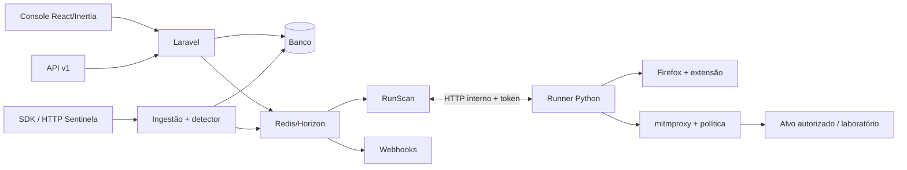

# Arquitetura

A Égide tem dois fluxos que compartilham Laravel, banco e fila: **sessões de avaliação** e **Sentinela**. O frontend é React/Inertia; as rotas web e API entram em controladores Laravel. A avaliação acontece em um runner Python isolado. [Rotas web](../routes/web.php), [rotas API](../routes/api.php), [entrada React](../resources/js/egide.jsx).

## Fluxo de avaliação

1. [ConsoleController](../app/Http/Controllers/ConsoleController.php) ou [ScanApiController](../app/Http/Controllers/Api/ScanApiController.php) valida o pedido. API e agenda passam por [Launcher](../app/Security/Launcher.php); o console também cria sessões de laboratório.
2. A transação grava [Scan](../app/Models/Scan.php), um evento inicial e despacha [RunScan](../app/Jobs/RunScan.php) após commit.
3. `RunScan` reserva um runner por lock, revalida o domínio externo e envia escopo, orçamento e política de segurança para `/start`. O [servidor Python](../runner/server.py) inicia Firefox e o [proxy](../runner/policy.py), cuja barreira inclui [guard.py](../runner/guard.py).
4. O job incorpora a superfície importada do ambiente, navega ou executa o roteiro do laboratório, acumula inventário e evidências, controla orçamento por fase, faz a varredura de configuração e encerra a sessão. Em alvo externo, o proxy pode pausar a sessão diante de sinais de dano. A interface consulta eventos e a imagem do navegador; o relatório é JSON ou uma página imprimível. [SurfaceImport](../app/Security/SurfaceImport.php), [BudgetLedger](../app/Security/BudgetLedger.php), [RunScan](../app/Jobs/RunScan.php).
5. A conclusão compara somente achados confirmados com uma sessão anterior e pode despachar [NotifyScan](../app/Jobs/NotifyScan.php). Achados e observações aparecem separados no console e na API. Veja [sessões](domains/scans.md), [escopo](domains/scope-and-runner.md) e [agente](domains/agent-and-oracles.md).

## Fluxo do Sentinela

`POST /api/sentinela/eventos` autentica pela chave do monitor e recebe um lote. [Ingest](../app/Sentinel/Ingest.php) valida e persiste os eventos; [Detector](../app/Sentinel/Detector.php) consulta janelas de tempo, cria ou atualiza alertas e despacha [NotifyAlert](../app/Jobs/NotifyAlert.php) quando necessário. Veja [Sentinela](domains/sentinel.md).

## Fronteiras e falhas

- **Laravel → runner:** HTTP interno autenticado por `EGIDE_RUNNER_TOKEN`; os endpoints e a validação do payload estão em [server.py](../runner/server.py) e [session_extras.py](../runner/session_extras.py). Alterar payload ou resposta requer examinar ambos os lados.
- **Runner → alvo:** toda saída do navegador passa pela política do mitmproxy; o job também faz validações de escopo. O proxy aplica a decisão final de escopo, escrita, ritmo e parada para cada requisição. [policy.py](../runner/policy.py), [guard.py](../runner/guard.py).
- **Jobs → dados:** estado persistente da sessão, eventos, cobertura e achados ficam no banco. A imagem atual fica no storage privado. Segredos copiados para a sessão são apagados ao terminar. [RunScan](../app/Jobs/RunScan.php), [ConsoleController](../app/Http/Controllers/ConsoleController.php).
- **Isolamento de usuários:** controladores e middleware verificam usuário, conta ativa e propriedade dos registros. [routes/web.php](../routes/web.php), [AuthenticateApiToken](../app/Http/Middleware/AuthenticateApiToken.php).

## Ambientes

Local: SQLite, Laravel no host, Redis/Mailpit e três runners em [compose.yaml](../compose.yaml). Produção: app PHP/Apache, Horizon, scheduler, PostgreSQL, Redis, Mailpit e três runners em [docker-compose.prod.yml](../docker-compose.prod.yml). Os runners usam a imagem de [runner/Dockerfile](../runner/Dockerfile). Veja [operação local](operations/local.md) e [produção](operations/production.md).
