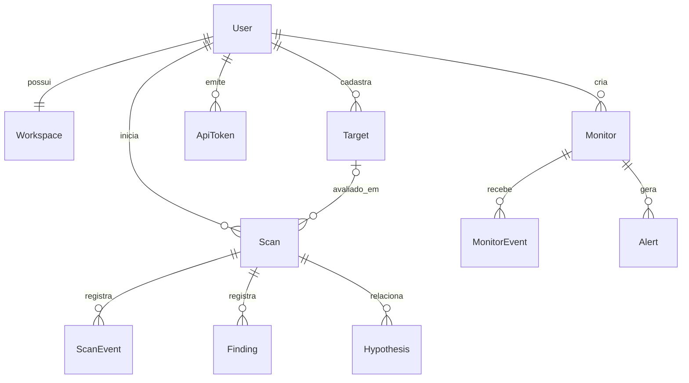

# Modelo de dados e estados

As fontes do esquema são as [migrações](../database/migrations/2026_11_08_000001_create_escopo_tables.php), os [modelos](../app/Models/Scan.php) e as migrações posteriores. Esta página descreve as relações usadas nos fluxos; consulte a migração antes de mudar uma coluna.

| Dado | Papel no produto | Onde nasce e é consumido |
| --- | --- | --- |
| `User` e `Workspace` | Conta, demonstração e preferências, inclusive webhook de sessões | [AccessController](../app/Http/Controllers/AccessController.php), [Workspace](../app/Models/Workspace.php) |
| `Target` | Origem, escopo, prova de domínio, tipo de ambiente, contas de teste, política de segurança e superfície importada | [ConsoleController](../app/Http/Controllers/ConsoleController.php), [SurfaceController](../app/Http/Controllers/SurfaceController.php), [Scope](../app/Security/Scope.php) |
| `Scan` | Sessão: modo, orçamento, estado, resultado, cobertura e resumo, incluindo superfície vista/testada | [Launcher](../app/Security/Launcher.php), [RunScan](../app/Jobs/RunScan.php) |
| `ScanEvent` e `Finding` | Linha do tempo; `Finding.track` separa achado confirmado (`achado`) de observação (`observacao`) | [RunScan](../app/Jobs/RunScan.php), [Finding](../app/Models/Finding.php), [relatório](../app/Http/Controllers/ConsoleController.php) |
| `Hypothesis` | Modelo persistente de hipóteses associado à sessão, com estado, tentativas e custo; ainda não é gravado pelo fluxo de `RunScan` | [Hypothesis](../app/Models/Hypothesis.php), [migração](../database/migrations/2026_11_14_000003_create_hypotheses_table.php) |
| `Platform` | Provedor/modelos de IA e limite diário globais | [AdminController](../app/Http/Controllers/AdminController.php), [Engine](../app/Security/Engine.php) |
| `ApiToken` | Acesso à API v1 | [IntegrationController](../app/Http/Controllers/IntegrationController.php) |
| `Monitor`, `MonitorEvent`, `Alert` | Fonte, telemetria e alertas do Sentinela | [Ingest](../app/Sentinel/Ingest.php), [Detector](../app/Sentinel/Detector.php) |
| `CollaboratorHit` | Callback fora de banda para prova de SSRF | [CollaboratorController](../app/Http/Controllers/Api/CollaboratorController.php) |

## Estados da sessão

`queued` é o estado inicial; `running` começa após reserva do runner. `completed` registra conclusão, enquanto `failed` e `cancelled` encerram execução por erro ou solicitação de parada. `phase` descreve a etapa para a interface; `result` pode distinguir mapeamento, exposição, proteção, desafio humano ou inconclusão. Não confunda `status` da execução com vereditos individuais de cobertura (`falha`, `protegido`, `nao_testado`). [RunScan](../app/Jobs/RunScan.php), [ConsoleController](../app/Http/Controllers/ConsoleController.php), [Scan](../app/Models/Scan.php).

## Achados, observações e hipóteses

`Finding` recebe `track=achado` por padrão. O modelo também aceita `observacao`; console, API e relatório apresentam as duas trilhas separadamente. Contagens de severidade, portão de CI, regressão e webhook usam apenas `achado`. `Finding` guarda vetor e pontuação CVSS 3.1; [Severity](../app/Security/Severity.php) calcula os valores a partir de `evidence.impact` quando disponível e usa a severidade como fallback. [Finding](../app/Models/Finding.php), [ScanApiController](../app/Http/Controllers/Api/ScanApiController.php), [NotifyScan](../app/Jobs/NotifyScan.php), [ObservationTrackTest](../tests/Feature/ObservationTrackTest.php).

`Hypothesis` define `pendente`, `confirmado`, `refutado`, `bloqueado`, `sem_orcamento` e `rejeitado`, além de relação com sessão e hipótese pai. Há migração e testes do modelo; o fluxo atual de `RunScan` não cria hipóteses persistidas. [Hypothesis](../app/Models/Hypothesis.php), [HypothesisModelTest](../tests/Feature/HypothesisModelTest.php).

## Segredos e retenção

`Target.credentials`, `Scan.credentials`, `Scan.engine_key`, `Workspace.api_key`/`webhook_url` e `Platform.ai_key` usam casts criptografados. Chaves do Sentinela e tokens de API são guardados como hash e mostrados na emissão. `RunScan` limpa credenciais e chave da cópia da sessão no encerramento. O scheduler remove eventos antigos do Sentinela, alertas resolvidos antigos e contas de demonstração expiradas. [modelos](../app/Models/Target.php), [RunScan](../app/Jobs/RunScan.php), [routes/console.php](../routes/console.php).

## Para mudar o esquema

Crie migração em vez de editar migrações já aplicadas; confira casts, validação dos controladores, serialização para a interface/API e testes do fluxo. Consulte [guia de mudanças](operations/change-guide.md) e [testes](operations/testing.md).
