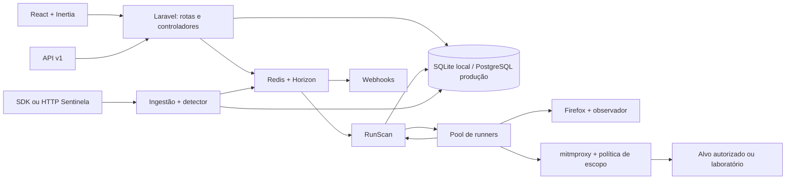

# Égide AI: descoberta do produto, arquitetura e plano de documentação

**Estado:** levantamento para revisão. Este arquivo descreve o comportamento observado no código em 16/11/2026 e propõe documentação futura. Não substitui o README nem os documentos de design.

## 1. Descrição do produto

A Égide AI é uma plataforma para avaliações de segurança **autorizadas** em aplicações web e APIs. O usuário cadastra um ambiente, define métodos e rotas permitidos, comprova controle do domínio e inicia uma sessão. A plataforma navega no alvo em um executor isolado, observa endpoints e, quando o ambiente permite, executa verificações de segurança. Um achado só é registrado quando uma regra de confirmação produz evidência; o relatório também registra cobertura e verificações inconclusivas. Há um laboratório sintético com variantes vulnerável e corrigida para demonstração e reteste. Um segundo produto, o Sentinela, recebe eventos de autenticação e acesso da aplicação monitorada, detecta padrões suspeitos e emite alertas. [README](../../README.md), [rotas web](../../routes/web.php), [rotas API](../../routes/api.php).

### Pessoas, entradas e resultados

| Papel | Ação principal | Resultado observável | Código de entrada |
| --- | --- | --- | --- |
| Visitante da demonstração | Entra em conta temporária e roda o laboratório | Sessão, achados e relatório do alvo sintético | [AccessController](../../app/Http/Controllers/AccessController.php), [Demo](../../app/Security/Demo.php) |
| Usuário de workspace | Cadastra e verifica um ambiente, cria sessão e consulta resultados | Inventário, eventos, evidências, cobertura, relatório JSON e página imprimível | [ConsoleController](../../app/Http/Controllers/ConsoleController.php) |
| Integrador | Cria token, inicia e consulta sessão pela API; configura agenda ou webhook | Estado da sessão e decisão do portão de CI | [ScanApiController](../../app/Http/Controllers/Api/ScanApiController.php), [IntegrationController](../../app/Http/Controllers/IntegrationController.php) |
| Operador do Sentinela | Cria monitor, integra SDK ou HTTP e acompanha alertas | Eventos aceitos, alertas e webhook | [SentinelController](../../app/Http/Controllers/SentinelController.php), [IngestController](../../app/Http/Controllers/Api/IngestController.php) |
| Super admin | Configura o motor de IA, observa a plataforma, pausa ou encerra sessões e suspende contas | Controle global da execução | [AdminController](../../app/Http/Controllers/AdminController.php) |

O produto hoje usa um workspace por usuário; a demonstração usa workspaces temporários. A administração é global, por `is_admin`. Isso não equivale a times com papéis internos. [AccessController](../../app/Http/Controllers/AccessController.php), [User](../../app/Models/User.php), [README](../../README.md).

### Capacidades atuais, por fluxo

1. **Ambientes e autorização.** O cadastro guarda origem web, origem opcional de API, rota inicial, regras permitidas, rotas negadas, tipo de ambiente, contas de teste opcionais e opção controlada de teste de escrita. A verificação usa TXT DNS ou arquivo HTTPS. A autorização é revalidada ao iniciar uma sessão externa. Alvos locais têm um modo próprio, condicionado à configuração local. [ConsoleController](../../app/Http/Controllers/ConsoleController.php), [Scope](../../app/Security/Scope.php), [Launcher](../../app/Security/Launcher.php).
2. **Sessão de pentest.** Pode ser laboratório, reteste do laboratório ou ambiente externo. A sessão externa exige motor de IA configurado. O laboratório pode usar roteiro próprio; a IA é opcional nele. O usuário vê andamento, eventos, imagem do navegador, achados, cobertura e relatório. [ConsoleController](../../app/Http/Controllers/ConsoleController.php), [RunScan](../../app/Jobs/RunScan.php).
3. **Exploração e confirmação.** A IA escolhe ações de navegação e pontos de ataque, mas o código filtra escopo e classe de ação. O inventário combina tráfego observado e rotas inferidas do bundle. Payloads e oráculos verificam autorização entre contas, injeções, exposição, configuração e outras classes. A caça agêntica propõe experimentos adicionais sujeitos a validação. O resumo executivo usa apenas fatos da sessão; o risco não pode ficar abaixo do achado de maior severidade. [Planner](../../app/Security/Planner.php), [AgenticRun](../../app/Security/AgenticRun.php), [HuntsAgentically](../../app/Jobs/Concerns/HuntsAgentically.php), [RunScan](../../app/Jobs/RunScan.php).
4. **Sentinela.** Recebe lotes de até 100 eventos com chave do monitor. Identidades de usuário entram como hash, não como e-mail ou nome. Detecta força bruta, credential stuffing, possível tomada de conta, rajada de acesso negado e anomalia de falhas. Alertas são deduplicados por impressão digital de regra, origem, identidade e hora; um alerta novo pode disparar webhook. [IngestController](../../app/Http/Controllers/Api/IngestController.php), [Ingest](../../app/Sentinel/Ingest.php), [Detector](../../app/Sentinel/Detector.php).
5. **Automação.** Há API v1 para listar ambientes verificados, criar sessão e consultar o resultado; agendas diárias ou semanais; webhook de sessão; fluxo de exemplo para GitHub Actions. [routes/api.php](../../routes/api.php), [routes/console.php](../../routes/console.php), [NotifyScan](../../app/Jobs/NotifyScan.php), [exemplo de CI](../../public/ci/egide-github-action.yml).

## 2. Arquitetura implementada

**Frontend.** React 19, Inertia 2, Vite e Tailwind 4. A lista de páginas fica em [resources/js/egide.jsx](../../resources/js/egide.jsx); as telas ficam em `resources/js/egide/pages/`. Os controladores Laravel montam as props das páginas. [package.json](../../package.json).

**Backend e persistência.** Laravel 12 em PHP 8.2+; modelos Eloquent e migrações para usuários/workspaces, ambientes, sessões, eventos, achados, monitores e alertas. Sessões têm UUID; achados e eventos pertencem à sessão. Chaves de IA e credenciais de teste usam casts criptografados; tokens de API e monitor são armazenados como hash. [composer.json](../../composer.json), [migrações](../../database/migrations/2026_11_08_000001_create_escopo_tables.php), [Scan](../../app/Models/Scan.php), [Target](../../app/Models/Target.php).

**Orquestração.** `RunScan` é um job Horizon. Ele obtém lock de um runner livre; se todos estiverem ocupados, retorna à fila. Revalida a autorização, inicia o runner, executa laboratório ou alvo externo, varre configuração, salva cobertura e finaliza a sessão. Em falha, cancelamento ou conclusão, tenta parar o runner e limpa a chave do motor e as credenciais copiadas para a sessão. O scheduler dispara sessões agendadas, limpa dados da demonstração, retém dados do Sentinela e encerra sessões presas. [RunScan](../../app/Jobs/RunScan.php), [routes/console.php](../../routes/console.php).

**Executor.** Um serviço Python controla Firefox ESR, extensão observadora, mitmproxy e laboratório. A comunicação com Laravel usa endpoints HTTP internos autenticados por token. O proxy aplica host, método, rota, negações, orçamento, limites de escrita e verificações contra caminhos malformados. O navegador opera em perfil separado. [runner/server.py](../../runner/server.py), [runner/policy.py](../../runner/policy.py), [runner/addon.js](../../runner/addon.js), [runner/lab.py](../../runner/lab.py).

**Execução local e produção.** Localmente, `bin/egide` prepara dependências, banco SQLite, assets, Redis e runners Docker, inicia Horizon e o servidor Laravel. `compose.yaml` contém Redis, Mailpit e três runners. Em produção, `docker-compose.prod.yml` contém app Apache/PHP, Horizon, scheduler, PostgreSQL, Redis, Mailpit e três runners; o entrypoint do app executa migrações e pode semear o administrador. [bin/egide](../../bin/egide), [compose.yaml](../../compose.yaml), [docker-compose.prod.yml](../../docker-compose.prod.yml), [Dockerfile](../../Dockerfile), [docker/entrypoint.sh](../../docker/entrypoint.sh).

### Ciclo de uma sessão

1. O controlador ou a API validam usuário, ambiente, escopo, cotas e configuração do motor. A criação grava `Scan` e agenda `RunScan` após o commit. A API e a agenda usam `Launcher`; o console cria a sessão em seu próprio controlador. [ConsoleController](../../app/Http/Controllers/ConsoleController.php), [Launcher](../../app/Security/Launcher.php).
2. O job reserva um runner e confirma novamente a propriedade do domínio. Envia escopo e orçamento para `/start`. [RunScan](../../app/Jobs/RunScan.php), [runner/server.py](../../runner/server.py).
3. No laboratório, usa alvo sintético; no externo, navega, mapeia endpoints e só executa testes agressivos quando o ambiente e o escopo permitem. Testes entre contas exigem credenciais e marcadores adequados. [RunScan](../../app/Jobs/RunScan.php), [Scope](../../app/Security/Scope.php).
4. O runner devolve observações e respostas. O job registra eventos, cobertura e achados com evidência; faz a varredura de configuração, gera resumo quando houver IA e encerra. [RunScan](../../app/Jobs/RunScan.php), [ProbesInjectionPoints](../../app/Jobs/Concerns/ProbesInjectionPoints.php).
5. O usuário consulta a sessão ou exporta JSON / página imprimível. A conclusão pode comparar achados com a sessão anterior e enviar webhook. [ConsoleController](../../app/Http/Controllers/ConsoleController.php), [NotifyScan](../../app/Jobs/NotifyScan.php).

### Modelo de dados, em linguagem de produto

| Entidade | O que representa | Relação principal |
| --- | --- | --- |
| `User` / `Workspace` | Conta e preferências do espaço individual | Um workspace por usuário |
| `Target` | Ambiente autorizado e suas regras | Pertence ao usuário; pode ter sessões |
| `Scan` | Sessão e seu estado, escopo e resultado | Pertence ao usuário; pode referenciar ambiente |
| `ScanEvent` / `Finding` | Linha do tempo e achado comprovado | Pertencem à sessão |
| `Platform` | Motor de IA e limite diário globais | Configuração global |
| `ApiToken` | Credencial da API v1 | Pertence ao usuário |
| `Monitor` / `MonitorEvent` / `Alert` | Fonte de telemetria, eventos e alertas do Sentinela | Monitor pertence ao usuário |
| `CollaboratorHit` | Callback recebido durante verificação fora de banda | Ligado à sessão/token |

Fontes: [modelos](../../app/Models/Scan.php), [migração de escopo](../../database/migrations/2026_11_08_000001_create_escopo_tables.php), [migração do Sentinela](../../database/migrations/2026_11_09_000001_create_sentinela_tables.php), [migração do colaborador](../../database/migrations/2026_11_09_000012_create_collaborator_hits.php).

## 3. Regras que agentes precisam preservar

- Avaliações externas exigem comprovação de controle do domínio. O cadastro gera a configuração de verificação; a autorização é conferida antes de iniciar a sessão e novamente no job. [Scope](../../app/Security/Scope.php), [RunScan](../../app/Jobs/RunScan.php).
- O proxy é a barreira final de host, método, caminho e orçamento. Uma checagem em PHP não substitui essa barreira. [runner/policy.py](../../runner/policy.py), [tests/runner/test_policy.py](../../tests/runner/test_policy.py).
- Ambiente marcado como produção fica sem bateria agressiva e sem regra de escrita; laboratório e ambientes de teste têm permissões próprias. Rotas destrutivas são filtradas. [RunScan](../../app/Jobs/RunScan.php), [Scope](../../app/Security/Scope.php), [ScopeGateTest](../../tests/Feature/ScopeGateTest.php).
- Propostas da IA passam por schemas e validações. Um achado precisa de confirmação objetiva; ausência de resposta suficiente deve resultar em `nao_testado`, não em `protegido`. [Planner](../../app/Security/Planner.php), [Hunter](../../app/Security/Hunter.php), [PayloadOracles](../../app/Security/PayloadOracles.php).
- O reteste entre contas inconclusivo não confirma correção. A parada por usuário/admin e a limpeza de segredos precisam funcionar mesmo quando o job falha. [RunScan](../../app/Jobs/RunScan.php).
- Eventos do Sentinela não devem receber identidade em texto claro. Tokens/chaves têm hash no banco; webhooks exigem destino HTTPS público. [Ingest](../../app/Sentinel/Ingest.php), [ApiToken](../../app/Models/ApiToken.php), [Webhook](../../app/Sentinel/Webhook.php).

## 4. Evidência de testes e limites desta descoberta

Há testes PHP de unidade e de fluxo para escopo, oráculos, sessão, agente, laboratório, Sentinela, API, CI, administração e automação; os testes Python cobrem política do proxy e laboratório. Os comandos declarados pelo projeto são `php artisan test` e `python3 -m unittest discover -s tests/runner`. O caminho com Firefox e mitmproxy reais depende do runner Docker. Esta descoberta é leitura estática: os testes e o fluxo ponta a ponta não foram executados para este PR. [tests](../../tests), [README](../../README.md).

### Diferenças a resolver antes dos guias definitivos

| Assunto | Evidência atual | Tratamento proposto |
| --- | --- | --- |
| Orçamento de requisições | O README descreve laboratório até 300 e externo até 180. `Scope::budget()` permite laboratório até 600, externo de teste até 2000 e externo de produção até 180; a API v1 valida pedidos até 180. | Documentar cada limite por entrada e ambiente; confirmar o valor desejado para o produto. |
| Orçamentos do agente | O README menciona profundidade 2 e 40 decisões; `config/egide.php` define profundidade 3 e 80 chamadas, além de 60 passos de caça fora da demo. | Usar a configuração efetiva como referência técnica e pedir decisão sobre os valores de produto. |
| Portão de CI e regressão | O README diz que regressão reprova o portão. `ScanApiController::present()` calcula `portao.passou` com sessão concluída e zero achados críticos/altos; não consulta `regression`. | Confirmar a regra desejada antes de documentar o contrato como definitivo. |
| Documento de design agêntico | O [design de 09/11](../superpowers/specs/2026-11-09-egide-nucleo-agentico-design.md) está marcado como aprovado para planejamento e descreve a base da época; o código já contém `AgenticRun`, `Hunter` e testes posteriores. | Tratar design e planos como histórico de decisões, não como inventário de funcionalidades atuais. |

Estas diferenças são observações de documentação e contrato; este PR não altera o comportamento do produto.

## 5. Plano para documentação voltada a agentes

**Objetivo:** criar um conjunto pequeno de arquivos Markdown, útil no GitHub e no Obsidian, que leve um agente do pedido do usuário ao código, aos invariantes e aos testes certos. Usar links relativos Markdown para funcionar nos dois leitores. Manter o README como apresentação pública do produto.

### Ordem de implementação em PRs seguintes

1. **Validar este mapa.** Revisar as quatro diferenças acima, confirmar público principal, regras de produto e o que ainda é protótipo. Resultado: lista de decisões e dúvidas resolvidas, sem transformar suposições em contratos.
2. **Criar entrada para agentes.** `AGENTS.md` curto na raiz com ordem de leitura, comandos, convenções e regra de consultar o mapa antes de alterar fluxos sensíveis. `docs/index.md` como índice navegável. Cada instrução deve apontar para uma fonte concreta.
3. **Documentar arquitetura e dados.** `docs/architecture.md` com diagrama, fronteiras Laravel/runner/Sentinela e ciclo da sessão; `docs/data-model.md` com relações, estados e segredos. Evitar catálogo de classes sem explicar fluxos.
4. **Documentar por domínio.** `docs/domains/scans.md`, `scope-and-runner.md`, `agent-and-oracles.md`, `sentinel.md` e `integrations.md`. Cada página terá: finalidade, entradas, sequência, dados, invariantes, pontos de extensão e testes relevantes.
5. **Documentar operação e contribuição.** `docs/operations/local.md`, `production.md`, `testing.md` e um guia de mudança por cenário: nova verificação, nova rota do runner, novo evento do Sentinela, nova tela. Registrar comandos reais de Windows e Unix quando diferirem.
6. **Revisar links e uso prático.** Validar links relativos, navegar do índice até cada fluxo, conferir exemplos com código/testes e simular duas tarefas de agente para ver se o guia aponta ao arquivo correto sem exigir leitura integral do repositório.

### Critérios para aceitar a documentação final

- Uma pessoa nova consegue explicar o ciclo completo de uma sessão e do Sentinela a partir do índice.
- Cada afirmação sobre segurança, limites e contratos aponta para implementação ou teste; decisões de produto ficam marcadas como decisões.
- O `AGENTS.md` é curto e encaminha para as páginas certas; não replica o README.
- As páginas distinguem produção, teste, laboratório e demonstração, incluindo limites diferentes.
- Comandos e links foram verificados no ambiente relevante; mudanças futuras incluem atualização da página afetada no mesmo PR.

## 6. Questões de produto para a revisão

1. Os limites implementados em `Scope::budget()` e `config/egide.php` são os desejados, ou os valores do README continuam sendo a política pretendida?
2. Uma regressão sem achado crítico/alto deve reprovar o portão de CI?
3. O produto prioritário para a documentação de agentes é o pentest externo, o laboratório de demonstração ou o Sentinela? Isso define a ordem de leitura e os exemplos.
4. Quais partes devem ser apresentadas como capacidade atual de produção e quais como experimento ou evolução planejada?
